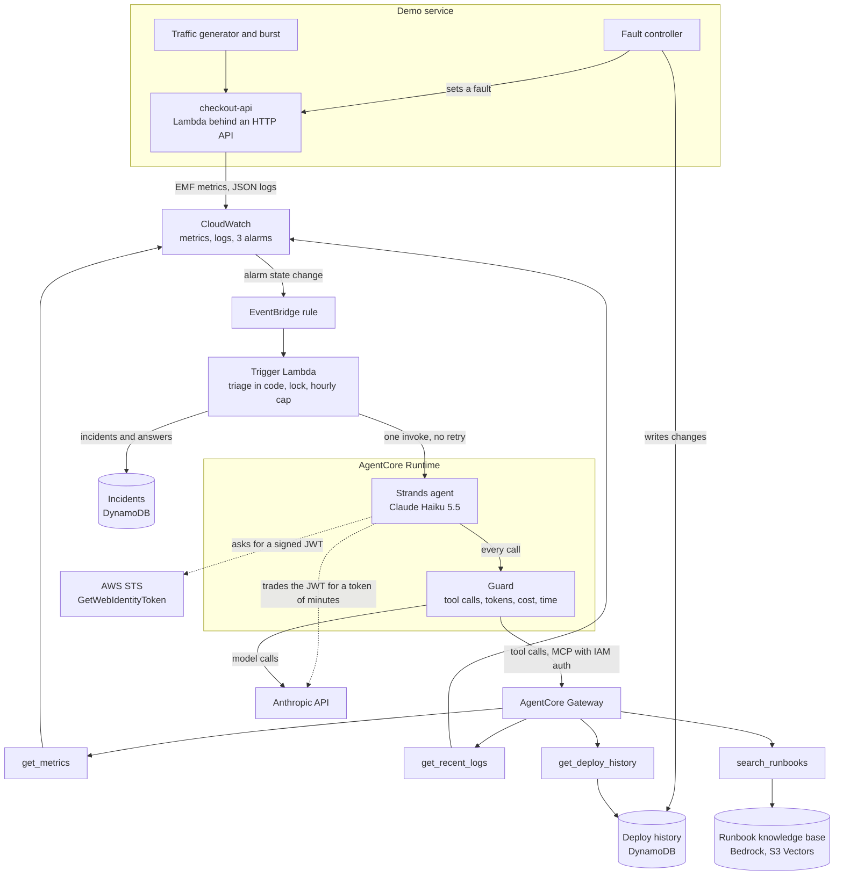

# SentinelOps

SentinelOps is an incident response agent I built on AWS. When a CloudWatch alarm fires on a small demo service, an agent on Bedrock AgentCore reads the service's metrics, logs, and deploy history, searches its runbooks, then answers with a root cause backed by typed evidence, each piece citing the exact tool result it came from. It reads and reasons; it can't change anything. Every investigation is bounded in code (tool calls, tokens, dollars, and time), and everything is deployed with Terraform from GitHub Actions.

- **55 of 55 runs diagnosed correctly** across 11 held-out incidents, including two where the right answer was "not my service".
- **A pre-registered evaluation that failed** on recall. I reported it as is and found the cause.
- **Hard limits in code** on tool calls, tokens, cost, and time, and no stored credentials in the agent or CI.
- **Runbook search over seven runbooks**, with the citation checked in code and retrieval measured on fresh queries.

**Where it stands:** diagnosis works end to end on live alarms and has been through a pre-registered evaluation, written up below. Runbook search is built and measured, also below. Remediation pull requests and the web UI aren't built yet. There's no public demo yet.

I built it with Claude Code as a pair programmer.

## Architecture



`ARCHITECTURE.md` has the full design, including the parts that are planned but not built.

## How a run works

1. **A fault starts.** The fault controller sets a flag the service reads, records in the deploy history whatever a real incident of that kind would leave there, and starts a 6-minute traffic burst.
2. **An alarm fires.** Three alarms watch 10-second periods: pool wait p99 over 100 ms, error rate over 5%, and latency p99 over 1,500 ms, each needing 2 of 3 periods to breach. On live breaks, the first alarm fired 36 to 42 seconds after the break.
3. **The trigger decides whether to investigate.** EventBridge forwards every alarm change to a Lambda. Triage is plain code, not a model: an alarm with no open incident opens one and starts a run, while a second alarm in the same incident, or the same alarm flapping, is recorded and starts nothing. Then the global limits apply: one investigation at a time, 20 an hour. The trigger calls the Runtime once and never retries.
4. **The agent investigates.** On AgentCore Runtime, a Strands agent running Claude Haiku 5.5 gets the alarm and four tools served by AgentCore Gateway: `get_metrics`, `get_recent_logs`, `get_deploy_history`, and `search_runbooks`. Each tool is its own Lambda with its own read-only IAM role. Every result comes back labeled (`m1`, `l2`, `d1`, `r1`) so the answer can cite it. Metrics are the primary source, because logs can lag by minutes under load. The prompt has it search the runbooks with what it measured, and treat a runbook's diagnosis steps as checks to run with the other tools, not as conclusions.
5. **Every call goes through the guard first.** It checks the limits below before each model call and each tool call.
6. **It answers with a `Hypothesis`.** That's a root cause, a confidence, and typed evidence items, each citing the result it came from: a value, a range, a count, a first or last occurrence, an absence, or a gap. It also lists the inferences it drew, what it didn't check, the affected component, and whether the fault is in this service, upstream, or undetermined. If its diagnosis follows a runbook, it names it, and code keeps that citation only if a search in the same run showed that runbook in full.
7. **The trigger stores it.** It stops the session, saves the answer and the run's full record on the incident in DynamoDB, and releases the lock.

Today the run ends there. Opening a pull request is Phase 4, but whether one may be opened is already decided in exactly one place, `Hypothesis.can_open_pr`: the run wasn't halted, the fault is in this service, and confidence is at least 0.7. A test fails the build if any other code compares a confidence or checks for a halted run.

## The fault scenarios

| Fault | What the data shows | Where the cause is | Status |
|---|---|---|---|
| Connection pool exhaustion | Pool wait climbs first, then latency, then errors a few minutes later. Requests time out waiting for a connection. | A config change in this service | Built |
| Bad deploy | Errors jump right after a release, on one route. Latency stays flat. | A bug in the new release | Built |
| Slow downstream | Checkout latency climbs and some checkouts time out upstream (504s), but this service's own error rate stays flat. | The payments dependency, not this service | Built |
| Memory leak | Latency creeps up over about 20 minutes. | This service | Planned, as a recorded window only |

The slow downstream is the one I care about most. The right answer is "this isn't my service's problem," and an agent that confidently blames the service it was paged for gets it wrong.

**Keeping the answer from the agent.** A fault's name never appears in a log line, a metric, or an alarm. Every break sends the same traffic burst, so the traffic's shape gives nothing away, and breaks also plant plausible but harmless changes, so the agent has to rule things out instead of blaming whatever changed. None of the agent's tools can read this repo. The repo tool planned for Phase 4 will see only the service's own code, never the simulator that stages the faults. The runbooks describe each kind of fault and how to check for it, never which one is running.

## Safety guards and cost bounds

The limits live in code, not in the prompt. A prompt that asks the model to stop at 15 tool calls is a suggestion; a counter is a limit. The model never sees the limits as rules, only how much budget is left, on each tool result.

**Per run** (`agent/guards.py`):

| Limit | Value |
|---|---|
| Tool calls | 15 |
| Input tokens, cumulative | 200,000 |
| Cost | $0.10 |
| Wall clock | 300 s |
| Resends of a malformed answer | 2 |

Hitting a limit doesn't throw. The run ends with a normal `Hypothesis` at confidence 0 that says which limit stopped it, and that answer can never open a PR.

**How the cost cap holds.** Before each model call, the guard reserves the most that call could cost: the prompt as the API's free `count_tokens` counts it, plus a 10% margin (at least 1,000 tokens), plus all 16,000 output tokens, at the dearest rate. If what's spent plus that reservation would pass $0.10, the call isn't sent. The count is an estimate, so in one narrow case a single call can take a run past the cap. The $10 monthly limit I set in the Anthropic Console is the backstop.

**Global limits** (`trigger/`): triage in code, a DynamoDB lock so only one investigation runs at a time, a cap of 20 an hour, and one invoke with no retries. The timeouts nest, each outlasting the one inside it: the guard's 300 s, the Runtime's 360 s, the trigger's 370 s wait, the Lambda's 410 s (room for the 10 s handoff to the remediation flow, with 20 s to spare), and the lock's 430 s.

**Access.** The agent can read and can't write. Each tool Lambda has its own scoped IAM role, and Gateway takes IAM auth only. The agent and CI hold no stored credentials: the agent signs in to Anthropic by workload identity federation, trading an STS-signed JWT for a token that lasts minutes, and GitHub Actions deploys through OIDC.

**Kill switch.** Disabling one EventBridge rule stops every new investigation. A running one ends within its 300 s, or at once if you stop its session. The remediation flow has its own: reserved concurrency 0 stops every new start, and stopping each running execution ends the ones already waiting on CI. The commands are under Running it locally.

**What it costs.** Idle, the AWS side runs about $5 to $15 a month, mostly the demo service's background traffic and high-resolution metrics. Model spend bills to Anthropic: under a cent a run on Haiku, $0.0084 on average with runbook search. `COSTS.md` has the breakdown and the guardrails.

## Evaluation

I wanted a result I couldn't adjust after the fact, so I committed the pass bar before the test sweep ran, and froze the code that shapes a run. The agent got every diagnosis right, and it still failed the bar.

**What was tested.** 11 alarms in 7 recorded windows, none of them replayed, swept, or tuned on before the test: 3 bad deploys, 6 pool exhaustion alarms, and 2 slow downstreams. Six windows came from live breaks after the freeze. The seventh was recorded earlier and held out. Each run replays the recorded tool data, so every run of an alarm sees the same data. I ran two models: Claude Haiku 5.5, the production model, 3 runs an alarm, and Claude Sonnet 5.5, 2 runs an alarm.

**55 of 55 runs diagnosed correctly, across 11 incidents.** All 33 Haiku runs and all 22 Sonnet runs named the right cause, scored both by a code rubric and by a blind audit, which agreed on every run. None was confidently wrong.

**The bar is about the evidence, not the diagnosis.** A code checker recomputes every typed evidence item from the tool result it cites and flags the ones that don't hold. A blind audit, done from the transcripts before any checker output was seen, labels every strict slip: a claim the run's own data doesn't support, such as a wrong number or a claim about data it never read.

- **Precision:** of the checker's flags, the share that hand-checking confirms. Bar: 85%.
- **Strict recall:** of the strict slips the audit found, the share the checker flagged on the right item for the right reason. Bar: 70%.

| | Haiku 5.5 | Sonnet 5.5 |
|---|---|---|
| Diagnoses right | 33 of 33 | 22 of 22 |
| Strict slips found by the audit | 100 (3.03 a run) | 61 (2.77 a run) |
| **Strict recall** (bar 70%) | **26%** (26 of 100; 95% CI 18-35%) | **2%** (1 of 61; 95% CI 0.3-9%) |
| Precision, form-only flags counted right (bar 85%) | 95% (35 of 37) | 75% (3 of 4) |
| Precision, form-only flags counted wrong | 78% (29 of 37) | 25% (1 of 4) |
| **Verdict** | **FAIL** on recall | **FAIL** on recall |

**Why recall failed.** Most slips aren't in the typed fields the checker reads. They're in the free-text note beside them, next to fields that hold. Two shapes account for most of them:

- **A claim about a period the run never read.** An older change gets ruled out with "flat until 02:30", when the metrics the run pulled start an hour later. The typed range covers only the rows it read, so the range holds and the note is unsupported.
- **A universal over a read that left lines out.** A note says every failing request shared some trait, beside an item over the 20 log lines shown, out of 43 found. The item holds over what it cites; the note claims all 43.

**Two precision readings.** A form-only flag marks an item whose facts all hold but whose typing is wrong, such as a value filed under the wrong column. I count those as right, since the item really is wrong as typed, the same way I called them during tuning, before this sweep. But I made the call for this sweep after seeing its flags, so the table shows both readings. Haiku clears the precision bar only under the first reading. Sonnet's 4 flags are too few to say anything: one flag moves its precision 25 points.

**Haiku vs Sonnet.** Haiku's 33 runs cost $0.20 in all, a mean of $0.0060 a run. Sonnet's 22 cost $2.15, a mean of $0.0975, about 16 times as much. For that, Sonnet got the same diagnoses with nearly as many strict slips a run (2.77 against 3.03). Its typed fields were almost always right; its slips sat in the notes. Production stays on Haiku, and the $0.10 cap rules Sonnet out anyway: the guard reserves $0.16 for its worst-case call.

**Caveats.**

- **Erratum, 2026-11-24.** From Phase 3 through 2026-11-23, the answer schema's examples included 1.43.0, TypeError, POOL_MAX_SIZE and 20->2: the bad deploy's release and error, and the pool fault's config key and its change. So the 3 bad-deploy and 6 pool exhaustion incidents in the 55-of-55 result weren't fully held out. The 2 downstream incidents had no leak like that. The prompt and schema did name payments-api, as the dependency whose latency and timeouts the metrics show and in two examples, but never the downstream fault itself: not its timeout setting, the 504, or the error type. The next evaluation cycle uses the clean schema.
- Three fault types on one small service: 55 of 55 shows the agent handles these well, not that it generalizes to new kinds of failure.
- The slip labels come from one labeler: Claude, working from the transcripts alone, blind to the checker. Claude also hand-checked the flags. I labeled 3 runs blind for the diagnosis and agreed on all 3.
- The intervals treat every item as independent, but slips cluster within runs, so the true intervals are wider. Even so, neither model's recall interval comes near 70%.

**The result stands.** I didn't move the bar or touch the frozen code. The next iteration's fix is to make those over-claims typed, so code can check them. A CI gate holds the agent in place. It fails if the prompt, the answer schema, the tool specs, or the model settings change without a new sweep, and it pins the rubric scores and the checker's verdicts on that sweep's answers. Runbook search changed the prompt, the schema, and the tool specs, so the gate's baseline is now the tuning sweep under Runbook search, not these 33 Haiku answers.

The full write-up, with per-fault numbers and how to reproduce the grade: [`agent/evals/reports/2026-11-18-test-sweeps.md`](agent/evals/reports/2026-11-18-test-sweeps.md). The bar is [`agent/evals/pass_bar.json`](agent/evals/pass_bar.json), and the audits and flag checks are in [`agent/evals/audits/`](agent/evals/audits/).

## Runbook search

Seven runbooks live in `runbooks/`: one for each fault the service injects, one for the planned memory leak, and three for faults it never injects (a slow database, a traffic surge, and Lambda throttling), so the closest runbook isn't always the right one. I drafted each from what the service actually does and reviewed them one at a time. Every runbook has the same five sections: Symptoms, What this is not, Diagnosis, Resolution, and Prevention.

**How the search works.** Each section is its own document in a Bedrock Knowledge Base on S3 Vectors, embedded with Titan Text Embeddings V2. `search_runbooks` makes one `Retrieve` call and ranks the runbooks by where their Symptoms or Diagnosis first comes back. The 2 closest come back in full (Symptoms, What this is not, and Diagnosis), the rest by name only. The tool shows no scores: on test queries that no runbook fits, the best score landed inside the range for queries one does fit, so a score can't say "none of these". The prompt tells the agent a runbook fits only if its Symptoms match what it measured and nothing in its What this is not applies.

**The citation is checked in code.** A runbook says what a kind of fault looks like, not what happened here, so it's never evidence: the checker flags any evidence item that cites a search. The answer names the runbook its diagnosis follows, and code keeps that only if a search in the same run showed that runbook in full. Otherwise the citation is cleared and logged with the reason, and the model isn't asked again.

**Retrieval, measured.** I wrote a fixed set of queries in the agent's own words, taken from how earlier runs described what they measured, and scored whether the right runbook lands in the top 2, the ones shown in full. The first round came in at 82% top-2, under my 90% bar, so I made five fixes to the runbooks and wrote 12 fresh queries the fixes never saw:

| | Knowledge base | Keyword baseline |
|---|---|---|
| Top-2, all 40 queries a runbook fits | **90%** (36 of 40) | 85% |
| Top-2, the 12 fresh queries | **83%** (10 of 12) | 83% |
| Top-1, all 40 | 75% | 65% |

- 90% meets the bar with no margin: one more miss would have failed it. The fresh 12 are the fairer number, since I made the fixes after seeing the first 28.
- Both fresh misses, and 3 of the 4 misses overall, are on `memory-leak.md`. The three faults the service injects land in the top 2 on 28 of 29 queries.
- A keyword baseline, counting the query's words in each runbook's Symptoms and Diagnosis, nearly tied the knowledge base on top-2 and tied it on the fresh queries. The knowledge base's clearer lead is on top-1.

The queries and the recorded searches are in [`tools/tests/fixtures/retrieval/`](tools/tests/fixtures/retrieval/).

**The tuning sweep.** 20 Haiku runs, one for each recorded alarm, with runbook search in. This is tuning data, not a held-out test: it includes the 11 alarms the test above already used. All 20 diagnoses were right, and every run cited its own fault's runbook, with none wrong and none dropped by the check. The ranking wasn't clean, though. On all 9 bad deploys the search put `downstream-timeout.md` first and `bad-deploy.md` second, and on 3 of 9 pool alarms the first search missed `db-pool-exhaustion.md`, so the agent searched again. Each time the right runbook was shown in full, and the agent picked it. The code rubric first failed 2 of the 20 on a phrase it misread ("returns 500 before reaching the database or payments-api" read as blaming payments-api). I read both by hand, fixed the rule, and both pass. Runs averaged $0.0084, up from $0.0060 in the test sweep, and the sweep cost $0.17. It's now the CI gate's baseline.

## What I'd change at scale

- **Isolation per tenant.** One AgentCore Runtime handles every incident here. With many teams, each team's agent needs its own identity and its own scoped tools, so one team's agent can't read another's logs.
- **Check the free text, not just the fields.** Checking typed evidence in code is precise (95% of Haiku's flags were real), but it misses most slips, because they live in prose. At scale I'd type more of the claims, like "unchanged over this period" and "every matching line", so code can check them, and put a model judge on the rest, measured against human labels before I trusted it.
- **More than one labeler.** Every slip label here is one labeler's, with my spot check on 3 runs. A production eval needs several human labelers, their agreement rate, and intervals that account for slips clustering within runs.
- **Calibrate the PR gate.** `can_open_pr` uses a 0.7 confidence threshold, and a model's self-reported confidence isn't calibrated. Every diagnosis in the test was right, so there's nothing to calibrate against yet. Production would calibrate on real outcomes, wrong answers included, and below the threshold the agent should page a human and say what it doesn't know.
- **Spend and concurrency per team.** One investigation at a time with a global hourly cap is right for a public demo and wrong for a company: one team's alarm storm would starve everyone else.
- **Logs that say when they're complete.** Under load, Logs Insights lagged by minutes, and `FilterLogEvents` sometimes returned fewer events with no error. So the agent treats metrics as primary and a log count as a floor. At scale I'd want a log pipeline that can tell the agent when a read is complete.

## What's next

- **Remediation** (Phase 4, next). A read-only repo tool, a patch drafted inside the guarded session, and a Lambda Durable Function with no model calls that validates the patch and opens one PR per fault mode.
- **The frontend** (Phase 5). A live trace of each run, a "Break the service" button, and a mobile layout.
- **One full evaluation cycle, after Phases 4 and 5**, so it measures the near-final agent. It brings the grader's next iteration (evidence kinds for "unchanged over a period" and "every matching line", a check for claims left in notes, and audit labels that record where each slip sits), synthesized windows for the memory leak and a few trap cases, a retrieval fix for `memory-leak.md` checked on a third round of fresh queries, a new pass bar and freeze, fresh test windows, and a new blind audit.
- **A public demo** (Phase 6), once there's something to click.

## Running it locally

### Tests

You need Python 3.12 and [uv](https://docs.astral.sh/uv/). Each project has its own tests, and none of them touches AWS, a model, or the network: the model is a mock HTTP transport, AWS is botocore's `Stubber` on recorded responses, and the tools replay recorded alarm windows.

```bash
(cd agent && uv run python -m pytest -q)
(cd tools && uv run python -m pytest -q)
(cd services/checkout-api && uv run python -m pytest -q)
(cd trigger && uv run python -m pytest -q)
(cd agent && uv run python -m evals.baseline check)   # what the model is sent, against the CI gate's baseline
```

### Your own deployment

Running the agent needs your own AWS account and Anthropic organization. There's no API key path, on purpose. You'll also want Terraform 1.16 (CI pins 1.16.2) and the AWS CLI v2.

1. **Bootstrap** (`infra/bootstrap/`, local state). It creates the state bucket, a $25 budget, the GitHub OIDC provider and deploy role, the permissions boundary, and IAM's outbound identity federation. First, point the deploy role's trust at your repo in `infra/bootstrap/main.tf`, since GitHub's subject names the owner and repo by numeric ID. Put `budget_email` in `infra/bootstrap/terraform.tfvars`. Then:
   ```bash
   terraform -chdir=infra/bootstrap init
   terraform -chdir=infra/bootstrap plan -out=bootstrap.tfplan
   terraform -chdir=infra/bootstrap apply bootstrap.tfplan
   ```
   Keep a copy of `infra/bootstrap/terraform.tfstate`. It isn't in the bucket.
2. **Anthropic federation** (the Claude Console). Add the issuer from `terraform -chdir=infra/bootstrap output outbound_federation_issuer_url`, a service account, and a federation rule whose subject is the runtime role's exact ARN, `arn:aws:iam::<account>:role/sentinelops-agent-runtime`. For local runs, add a second rule for `role/sentinelops-local`.
3. **GitHub.** Set the repository variables `AWS_DEPLOY_ROLE_ARN`, `TF_STATE_BUCKET`, and `AWS_REGION`, and a secret `ANTHROPIC_FEDERATION` holding `{"organization_id": "...", "service_account_id": "svac_...", "rule_id": "fdrl_..."}`. Then push to `main`: CI runs the tests, applies Terraform, smoke-tests the service, and loads the runbooks into the knowledge base, checking that it holds exactly this build.
4. **A local run.** Use an IAM user named `sentinelops-dev` in a `sentinelops` AWS CLI profile (`infra/local_sign_in.tf` trusts that name). Set `SENTINELOPS_ANTHROPIC_ORGANIZATION_ID`, `SENTINELOPS_ANTHROPIC_SERVICE_ACCOUNT_ID`, `SENTINELOPS_ANTHROPIC_FEDERATION_RULE_ID` (the local rule), and `SENTINELOPS_ANTHROPIC_ROLE_ARN` (`sentinelops-local`'s ARN). Then:
   ```bash
   cd agent
   uv run python -m main --alarm sentinelops-checkout-errors --as-of <a time just after it fired>   # a replay, within 7 days
   uv run python -m main --alarm sentinelops-checkout-errors                                        # live: the alarm must be in ALARM
   ```
   The `Hypothesis` goes to stdout as JSON, and the run's transcript to `agent/scratch/runs/`. Each run is a billed model call, under a cent. Before it starts, a local run checks that the knowledge base holds this checkout's runbooks, and refuses to start if it doesn't.
5. **Break the service.**
   ```bash
   echo '{"action": "break", "mode": "bad_deploy"}' > ctl.json   # or db_pool_exhaustion, downstream_timeout
   aws lambda invoke --function-name sentinelops-fault-controller --cli-binary-format raw-in-base64-out --payload file://ctl.json out.json
   ```
   A break runs a 6-minute traffic burst and clears itself after 390 seconds. Leave 10 quiet minutes between breaks, or triage counts the second as part of the first. With the `sentinelops-alarms` rule enabled, the alarm starts an investigation by itself, and the answer is stored on the incident in the `sentinelops-incidents` table.

### Kill switch

```bash
aws events disable-rule --name sentinelops-alarms --region us-east-1
aws bedrock-agentcore stop-runtime-session --agent-runtime-arn "$(terraform -chdir=infra output -raw agent_runtime_arn)" \
  --qualifier DEFAULT --runtime-session-id <session_id>   # the session ID is in the trigger's latest "investigating" log line
```

Terraform ignores the rule's on/off state, so a deploy never turns a stopped agent back on.

The remediation flow, which opens the PRs:

```bash
aws lambda put-function-concurrency --function-name sentinelops-remediation --reserved-concurrent-executions 0 --region us-east-1
aws lambda list-durable-executions-by-function --function-name sentinelops-remediation --statuses RUNNING --region us-east-1
aws lambda stop-durable-execution --durable-execution-arn <arn> --region us-east-1   # each one listed
# back on: aws lambda delete-function-concurrency --function-name sentinelops-remediation --region us-east-1
```

Concurrency 0 stops every new start and holds an execution that's waiting on CI, but Lambda resumes a held one once concurrency returns, so each running one is stopped too. A PR already open stays open, a draft unless its check passed, and nothing merges either way: merges are blocked on every branch. Terraform ignores the function's concurrency, so a deploy never lifts the switch.

## Repo layout

```
agent/                   the agent: loop, guard, prompt, Hypothesis, checker, evals
tools/                   the four tools, one uv project, a Lambda handler each; the runbooks' build and ingest
trigger/                 triage, the lock, the hourly cap, the call to the Runtime
services/checkout-api/   the demo service, its fault simulator and controller, traffic
infra/                   Terraform: bootstrap first, then everything else
runbooks/                the seven runbooks the agent searches
```

## Stack

| Layer | Choice |
|---|---|
| Agent runtime | Bedrock AgentCore Runtime |
| Agent framework | Strands Agents SDK |
| Tools | AgentCore Gateway (MCP) over four Lambdas |
| Runbook search | Bedrock Knowledge Base on S3 Vectors, Titan Text Embeddings V2 |
| Model | Claude Haiku 5.5 on the Anthropic API, signed in by workload identity federation |
| State | DynamoDB |
| Infrastructure | Terraform; GitHub Actions deploys with OIDC |
| Language | Python 3.12, managed with uv |

## License

MIT. See [`LICENSE`](LICENSE).
